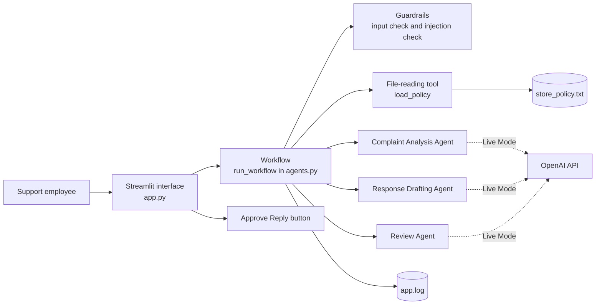
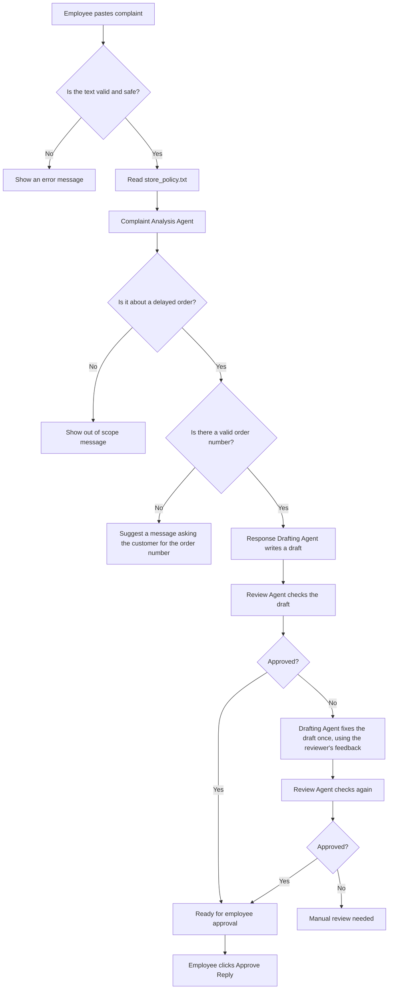

# Order Delay Complaint Assistant

## 1. Project Overview

**The problem:** Online stores get many complaints about late orders. Support employees spend a lot of time writing similar replies, and a rushed reply can break store rules, for example by promising a delivery date nobody confirmed or by showing a customer's full order number.

**Who it helps:** Customer support employees at a fictional online store called "Oasis Market".

**What the app does:** The employee pastes a customer's complaint into a Streamlit page. Three AI agents then work together:

1. One agent reads the complaint and pulls out the facts.
2. One agent writes a short, polite English reply based on the store policy.
3. One agent reviews the reply and sends it back for one fix if it breaks a rule.

The reviewed reply appears with an **Approve Reply** button. Nothing counts as approved until the employee clicks it. The app handles **order delays only**, and it never invents an order number, a shipment status or a delivery date.

## 2. Project Structure

```
order-delay-complaint-assistant/
├── app.py             # The Streamlit web page: complaint box, buttons, results
├── agents.py          # The three agents, the workflow, guardrails and logging
├── store_policy.txt   # The fictional store policy the agents must follow
├── test_agents.py     # 17 automatic tests (no API key needed)
├── requirements.txt   # Python packages to install
├── .env.example       # Empty template for your OpenAI settings
├── .gitignore         # Keeps .env, logs and local folders out of GitHub
└── README.md          # This file
```

## 3. Architecture Diagram



## 4. Workflow Diagram



**In plain words:**

- **Order number missing:** the app does not guess a number. It suggests a polite message asking the customer for it. If the customer wrote a number that is too short (fewer than 4 digits), the message asks them to double-check it.
- **Reviewer sends the draft back (Reflection loop):** if the Review Agent finds a problem, such as a promised delivery date, it writes the reason. The reason goes back to the Drafting Agent, which writes **one** improved draft. The Review Agent checks it again. If it still fails, the app shows "manual review needed". The loop runs only once, so it can never repeat forever.
- **Draft ready:** a draft that passes review appears with the **Approve Reply** button. When the employee clicks it, the reply is marked as approved and added to the "Approved replies" list in the sidebar.

## 5. Agents and Their Roles

| Agent | Function | Receives | Returns |
|---|---|---|---|
| **Complaint Analysis Agent** | `analyze_complaint()` | The complaint text | Whether it is about a delay, the order number (or none), whether a number was too short, how many days late, and the customer's mood |
| **Response Drafting Agent** | `draft_reply()` | The store policy, the masked order number (like `***45`), the facts from the Analysis Agent, and the reviewer's feedback on a revision | A short English reply (2 to 4 sentences) |
| **Review Agent** | `review_draft()` | The draft, the real order number (only for checking) and the store policy | `approved` (true or false) and a clear reason if it fails |

**Why three agents?** Each agent has one simple job, so it is easier to understand, test and explain. Having a separate reviewer lets the system catch and fix its own mistakes.

**Safety built in:** the Drafting Agent never sees the complaint text, only the facts, so instructions hidden in a complaint can't reach it. The Review Agent always checks three fixed rules: no full order number, no promised delivery date, and an apology.

## 6. Technologies & AI Tools Used

- **Python** for all the code
- **Streamlit** for the web page (`st.session_state` remembers the result and approvals between clicks)
- **OpenAI API** for the three agents in Live Mode
- **python-dotenv** to load settings from a local `.env` file
- **pytest** for the automatic tests
- **Python `logging`** to record agent steps, decisions, file reads and errors in `app.log`, without complaint text, order numbers or API keys

**Demo Mode and Live Mode** (choose in the sidebar):

- **Demo Mode** runs the same workflow with fixed, rule-based answers. It needs no API key, always gives the same result, and is best for presentations and tests. The "Simulate a bad first draft" checkbox shows the Reflection loop.
- **Live Mode** sends each agent's task to the OpenAI API. It needs an API key in your `.env` file. If the key is missing or the API call fails, the app shows a clear error.

## 7. Installation and Setup Instructions

**1. Clone the repository**

```bash
git clone https://github.com/noufsaad-max/order-delay-complaint-assistant.git
cd order-delay-complaint-assistant
```

**2. Create and activate a virtual environment**

macOS / Linux:
```bash
python3 -m venv .venv
source .venv/bin/activate
```

Windows (PowerShell):
```powershell
python -m venv .venv
.\.venv\Scripts\Activate.ps1
```

If PowerShell says scripts are disabled, run this once and try again:
`Set-ExecutionPolicy -Scope CurrentUser -ExecutionPolicy RemoteSigned`

**3. Install the dependencies**

```bash
pip install -r requirements.txt
```

**4. (Live Mode only) Create your local `.env` file**

macOS / Linux:
```bash
cp .env.example .env
```

Windows (PowerShell):
```powershell
copy .env.example .env
```

Open `.env` and fill in your own values:

```
OPENAI_API_KEY=your key here
OPENAI_MODEL=the model name you want to use
```

If `OPENAI_MODEL` is empty, the app uses `gpt-4o-mini`. `.env` is listed in `.gitignore`, so your key is never uploaded to GitHub. Demo Mode does not need this step.

## 8. How to Run the Project

**Start the app:**

```bash
streamlit run app.py
```

The app opens in your browser at http://localhost:8501.

**Run the tests:**

```bash
python -m pytest -v
```

All 17 tests run in Demo Mode without an API key. They cover normal complaints, invalid input, failure cases (such as a missing policy file), a prompt-injection attack, and the one-revision Reflection loop.

**Try it with Arabic examples.** Complaints in Arabic, including Arabic digits, are understood, and the reply is in English:

1. Type `طلبي تأخر ثلاثة أيام` and click **Run the agents**. The app suggests a message asking the customer for the order number.
2. Type `طلبي رقم 12345 تأخر ثلاثة أيام` and click **Run the agents**. The app shows a reviewed reply with the order number hidden as `***45`. Click **Approve Reply** to approve it.

You can also use the example buttons on the page, including one that tests a prompt-injection attack.

## 9. Future Improvements

- Connect to a real, read-only shipment tracking system so replies can include confirmed shipping status.
- Let the employee edit the draft before approving it, and send approved replies through email or a ticket system.
- Support more complaint types, such as damaged items or refunds, each with its own policy file.

## 10. SDAIA Academy GitHub Repository Link

[SDAIA Academy GitHub](https://github.com/SDAIAAcademy)
